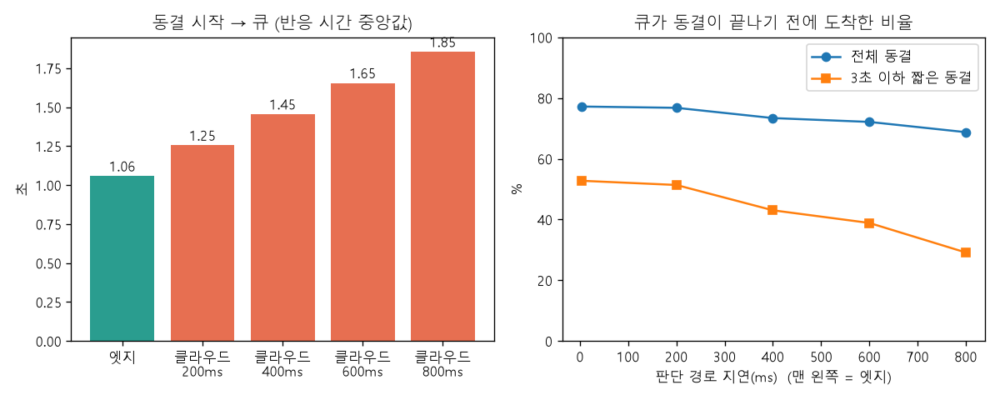

# 엣지 vs 클라우드 지연 비교 (13주차)

`src/cloud_latency.py`로 생성. 질문: **판단을 클라우드에서 하면 무엇이 나빠지는가?**

- 두 경로의 판단 방법은 같다(같은 모델, 임계값 0.8, 3윈도우 평균). 판단하는 장소만 다르다.
- 엣지 지연 3ms는 실측값([edge_metrics.md](edge_metrics.md)). 클라우드는 네트워크 왕복 지연 200~800ms를 더함
- 동결 에피소드 237개 (12주차 LOSO 확률로 감지한 190개 기준 반응 시간). 3초 이하 짧은 동결 72개

## 1. 반응 시간과 동결 중 도착

| 경로         |   지연(ms) |   반응 시간 중앙값(초) | 동결 중 도착(전체)   | 동결 중 도착(3초 이하 동결)   | 1초 안에 큐   |
|:-----------|---------:|---------------:|:--------------|:--------------------|:----------|
| 엣지         |        3 |           1.06 | 77.2%         | 52.8%               | 38.4%     |
| 클라우드 200ms |      200 |           1.25 | 76.8%         | 51.4%               | 34.6%     |
| 클라우드 400ms |      400 |           1.45 | 73.4%         | 43.1%               | 31.2%     |
| 클라우드 600ms |      600 |           1.65 | 72.2%         | 38.9%               | 27.8%     |
| 클라우드 800ms |      800 |           1.85 | 68.8%         | 29.2%               | 14.3%     |

- 반응 시간 = 동결 시작 → 큐. 감지 자체에 걸리는 시간(약 1초, 2초 윈도우를 채워야 함)이 대부분이고, 경로 지연이 그 위에 더해진다
- 동결 중 도착 = 큐가 동결이 끝나기 전에 울린 비율. 끝난 뒤 울리는 큐는 도움이 안 되고 오히려 혼란을 줌

## 2. 보내야 하는 데이터 양 (실제 MQTT 메시지 형식 기준)

|                 | 보내는 것             |   초당 메시지 |   초당 데이터(KB) |   하루 8시간(MB) |
|:----------------|:------------------|---------:|-------------:|-------------:|
| 클라우드 (올려야 하는 것) | 원시 가속도 9채널 × 64Hz |       64 |         7.64 |       214.98 |
| 엣지 (밖으로 나가는 것)  | 요약 이벤트 × 2Hz      |        2 |         0.35 |         9.94 |

## 3. 해석

- 클라우드 800ms면 반응 시간이 1.06초 → 1.85초로 늘고, 동결 중에 큐가 도착하는 비율이 77% → 69%로 줄어든다.
- 특히 **3초 이하 짧은 동결**에서 차이가 크다: 53% → 29%. 동결 길이의 중앙값이 5.3초로 짧아서, 몇백 ms 차이가 큐가 쓸모 있는지를 가른다.
- 데이터 양: 엣지는 밖으로 보내는 양이 약 22분의 1이다. 원시 움직임 데이터가 밖으로 나가지 않아 개인정보 면에서도 유리하다.
- 네트워크가 끊기면 클라우드 경로는 아예 큐를 줄 수 없다. 엣지는 혼자 계속 동작한다(14주차 안전 대비 동작).
- 그래서 **실시간 판단(빠른 층)은 엣지**, 세션이 끝난 뒤의 분석과 임계값 조정(느린 층, LLM)은 **클라우드**에 둔다. 느린 층은 몇 초가 걸려도 큐 타이밍에 영향이 없다.

## 4. 한계

- 네트워크 지연은 실제로 재지 않고 고정값을 더했다. 실제 망은 지연이 흔들리고(지터) 끊기기도 해서 클라우드에 더 불리하다.
- 서버의 처리 시간은 엣지와 같다고 가정했다(서버가 더 빨라도 0.07ms 수준이라 차이 없음).
