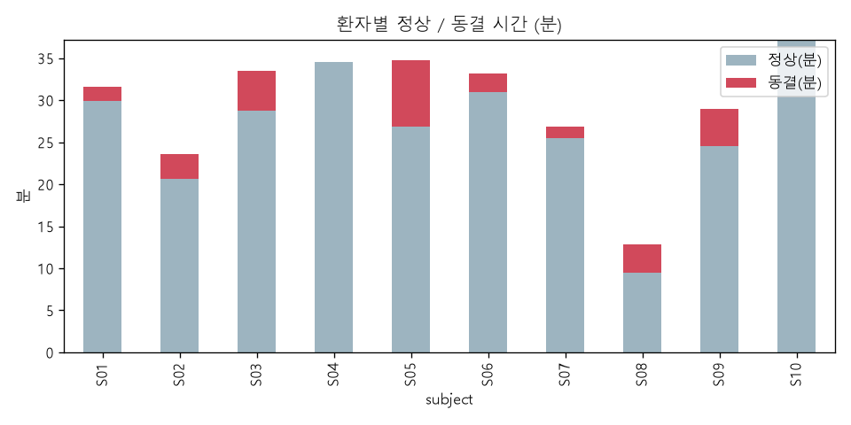
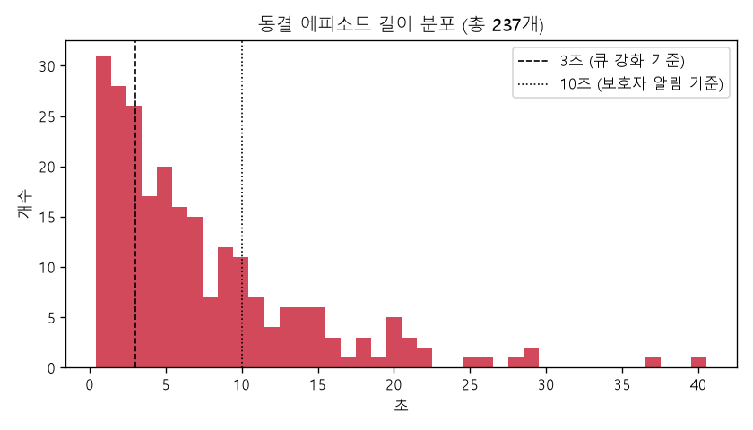
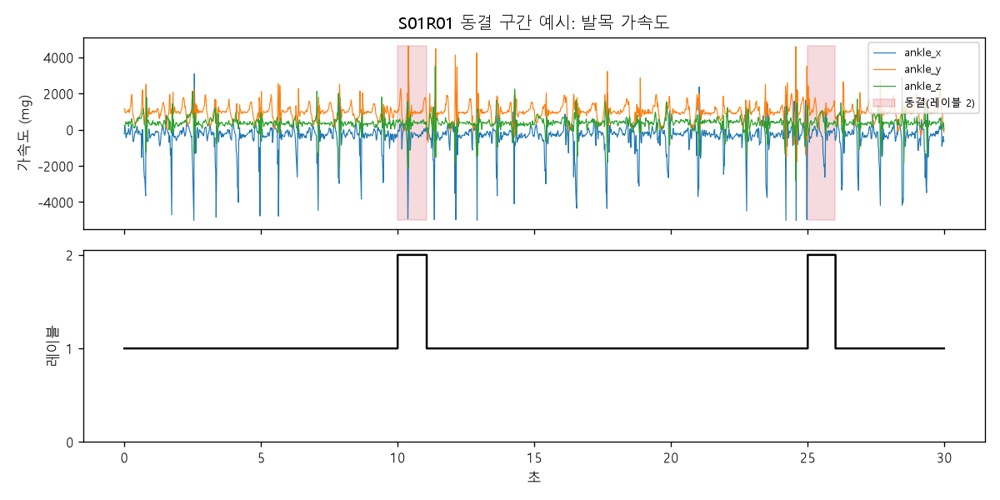

# 데이터 탐색 요약 (11주차)

`src/explore.py`로 생성. 샘플링 64Hz 기준으로 분 단위 환산.

| subject   |   실험외(분) |   정상(분) |   동결(분) |   에피소드 수 |   평균 길이(초) |   최장(초) |   10초 초과 |   동결 비율(%) |
|:----------|---------:|--------:|--------:|---------:|-----------:|--------:|---------:|-----------:|
| S01       |     21.5 |    29.9 |     1.7 |       23 |        4.5 |    15.2 |        3 |        5.4 |
| S02       |     18.7 |    20.6 |     3   |       24 |        7.6 |    18.4 |        7 |       12.7 |
| S03       |     32.4 |    28.7 |     4.8 |       49 |        5.8 |    20.7 |        9 |       14.3 |
| S04       |     16.5 |    34.5 |     0   |        0 |        0   |     0   |        0 |        0   |
| S05       |     20   |    26.9 |     7.9 |       66 |        7.2 |    28.6 |       13 |       22.7 |
| S06       |     24.1 |    31   |     2.2 |       10 |       13.1 |    40.5 |        4 |        6.6 |
| S07       |     17.4 |    25.5 |     1.4 |       24 |        3.4 |    11.5 |        1 |        5.2 |
| S08       |     22.7 |     9.5 |     3.3 |       14 |       14.4 |    21.4 |       11 |       25.8 |
| S09       |     15.9 |    24.5 |     4.5 |       27 |       10   |    37   |       10 |       15.5 |
| S10       |     13.2 |    37.2 |     0   |        0 |        0   |     0   |        0 |        0   |

- 전체 동결 에피소드: 237개, 중앙값 5.3초, 3초 초과 165개, 10초 초과 58개
- 동결이 없는 환자: S04, S10 → 시나리오 ③(행동하지 않음) 테스트용

