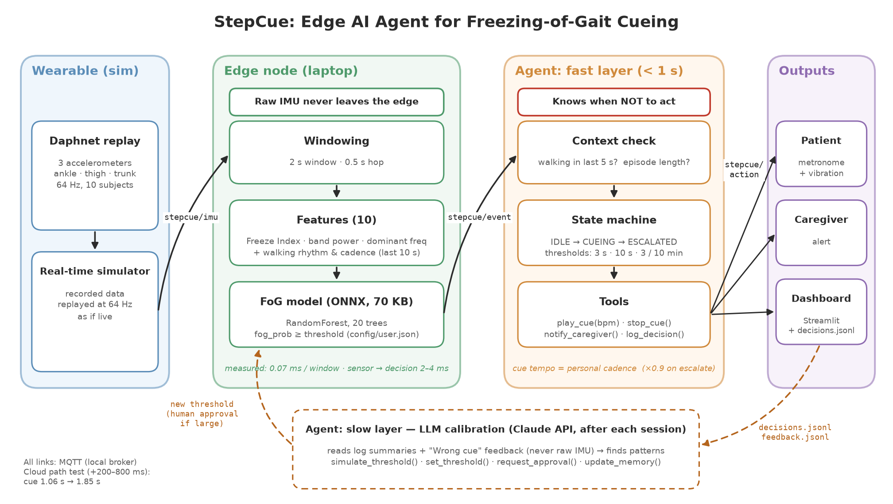

# 1페이지 설계: StepCue

> 수업 요구: *one-page design: data, events, agent tools, actions*. 문제 정의는 [problem_card.md](problem_card.md) 참고.
> 13주차 갱신: 두 단계 에이전트, MQTT 메시지 실제 형식, ONNX·지연 측정 결과, 개인 보정 실험 결과 반영.

## 0. 전체 구조


(다이어그램은 `scripts/make_diagram.py`로 생성. 아래는 텍스트 요약)
```
                 ┌──────────────── 실시간 경로 (엣지, 1초 미만, 인터넷 없이 동작) ────────────────┐
[웨어러블 시뮬레이터] --stepcue/imu--> [엣지 노드] --stepcue/event--> [빠른 층 에이전트] --stepcue/action--> [대시보드]
 Daphnet 64Hz 재생                     윈도우·특징·ONNX              규칙 상태 머신                   Streamlit
                                       (원시 데이터는 여기서 멈춤)    logs/decisions.jsonl           "잘못된 큐" 버튼
                                              ▲                                                         │
                                              │ config/user.json (임계값)                                │ logs/feedback.jsonl
                                              └──────────── [느린 층 에이전트: LLM 보정] <─────────────────┘
                                                             Claude API, 세션이 끝난 뒤 실행 (실시간 경로 밖)
```
- 모든 구성 요소는 노트북에서 실행하고, MQTT 브로커(Mosquitto 또는 `src/broker.py`)를 거쳐 통신한다.
- **두 단계로 나눈 이유:** 큐는 1초 안에 울려야 하므로 실시간 판단은 엣지의 규칙으로 한다. LLM은 몇 초가 걸리고 네트워크가 필요하므로, 세션이 끝난 뒤 로그를 보고 설정을 고치는 역할만 한다([cloud_latency.md](cloud_latency.md): 판단을 클라우드에서 하면 짧은 동결에 큐가 제때 도착하는 비율 53% → 29%).

## 1. Data
| 단계 | 내용 |
|---|---|
| 입력 | 가속도 9채널(발목·허벅지·몸통 × xyz), 64Hz |
| 윈도우 | 2초(128샘플), 0.5초마다 이동 |
| 특징 | 10개, 센서별 가속도 크기 기준: Freeze Index(동결 대역 3~8Hz 파워 ÷ 걷기 대역 0.5~3Hz 파워, log) ×3, 전체 파워 ×3, 발목 대역별 파워 ×2, 주된 주파수 ×2 (`src/features.py`) |
| 모델 | RandomForest(트리 20개, 깊이 6) → **ONNX 70KB** (`models/rf.onnx`). 베이스라인(Freeze Index 임계값)과 비교: [model_results.md](model_results.md) |
| 판단 | 최근 3윈도우 확률 평균 ≥ 임계값(**0.8, 모든 사용자 공통**). 값은 `config/user.json`에서 읽음 |
| 걷기 리듬 | 최근 10초 발목 가속도의 자기상관 → 걷는 중인지, 분당 걸음 수 (`src/cadence.py`) |
| 정답 | 윈도우 안 레이블 다수결(레이블 0 구간은 제외). 평가·대시보드 표시용이며 판단에는 쓰지 않음 |

## 2. Events (MQTT)
| 토픽 | 보내는 쪽 → 받는 쪽 | 빈도 | 예시 |
|---|---|---|---|
| `stepcue/imu` | 시뮬레이터 → 엣지 | 64Hz | `{"t": 1140.0, "acc": [9개 값], "label": 2, "sent": 1763800000.0}` (재생 시작 때 `{"reset": true}`) |
| `stepcue/event` | 엣지 → 에이전트·대시보드 | 2Hz | `{"t": 1144.5, "fog_prob": 0.91, "prob_avg": 0.85, "fog": true, "threshold": 0.8, "walking": true, "rhythm": 0.62, "cadence": 151, "infer_ms": 0.6, "latency_ms": 2.2, "truth": 1}` |
| `stepcue/action` | 에이전트 → 대시보드 | 행동할 때 | `{"t": 1144.6, "action": "cue_start", "bpm": 151, "reason": "걷던 중 동결 확률 0.85"}` |

- 원시 가속도(7.6KB/초)는 엣지 밖으로 나가지 않고, 요약 이벤트(0.35KB/초)만 나간다.
- 피드백과 결정 기록은 파일로 남긴다: `logs/decisions.jsonl`, `logs/feedback.jsonl`, `logs/threshold_changes.jsonl`

## 3. Agent tools
실제 소리나 진동 대신 메시지 발행과 대시보드 표시로 대신한다.

**빠른 층 (엣지, 규칙 기반, `src/agent.py`)**
| 도구 | 하는 일 |
|---|---|
| `estimate_cadence()` | 최근 10초 발목 가속도의 자기상관(보폭 주기)으로 분당 걸음 수 계산. 리듬이 약하면 "걷는 중 아님" |
| `play_cue(bpm, vibrate)` | 메트로놈 큐 시작 또는 템포 변경 |
| `stop_cue()` | 큐 중지 |
| `notify_caregiver(msg)` | 보호자 알림 발행 |
| `log_decision(...)` | 입력값, 행동, 이유를 `logs/decisions.jsonl`에 기록 |

**느린 층 (LLM 보정 에이전트, Claude API 도구 호출, `src/llm_agent.py`)**: 원시 가속도는 보내지 않고 로그 요약만 보낸다.
| 도구 | 하는 일 |
|---|---|
| `get_log_summary()` | 지난 세션의 결정 로그 요약(큐 횟수, 상황별 통계) |
| `get_feedback()` | "잘못된 큐였어요" 기록과 그때의 상황(확률, 걷기 리듬, 걸음 속도, 직전 행동) |
| `simulate_threshold(thr)` | 저장된 확률로 재생해서 그 임계값의 감지율·오탐을 미리 계산 |
| `set_threshold(thr, reason)` | `config/user.json` 변경 + `logs/threshold_changes.jsonl`에 기록 |
| `request_approval(msg)` | 큰 변경은 대시보드에 승인 요청 |
| `update_memory(note)` | 사용자별 패턴 메모를 `config/user_memory.json`에 저장 → 다음 실행 때 먼저 읽음 |

## 4. Actions
**빠른 층: 상태 머신 (세션 중, 0.5초마다)**
```
 IDLE ──동결 감지 + 직전 걷는 중──> CUEING ──3초 미회복──> ESCALATED
  ^                                  │                         │
  └──────────회복(큐 중지)────────────┴─────────────────────────┘
          ESCALATED에서 10초 초과 또는 10분 안에 3회 이상 → 보호자 알림
```
| 조건 | 행동 | 이유 |
|---|---|---|
| `prob_avg` < 임계값 | `no_action` | 동결 아님 |
| 확률은 높지만 직전 5초 동안 걷지 않음 | `no_action` | 일부러 멈춘 상태로 판단 |
| 걷던 중 확률 ≥ 임계값 | `cue_start` (bpm = 개인 걸음 속도) | 동결 시작 |
| 큐 시작 후 3초 넘게 회복 안 됨 | `cue_escalate` (bpm × 0.9, 진동 추가) | 큐가 안 통함 |
| 동결 10초 초과 또는 10분 안에 3회 이상 | `notify_caregiver` | 낙상 위험 |
| 확률이 임계값 아래로 2윈도우 연속 | `cue_stop` | 회복 |
| MQTT 연결 끊김 | 엣지 혼자 계속 판단·큐 | 네트워크 없이도 안전 |
| 센서 데이터 끊김 | 큐 중지 + 기록 | 잘못된 큐 방지 |

**느린 층: 피드백 학습 순환 (세션이 끝난 뒤)**
1. 사용자가 대시보드의 **"잘못된 큐였어요"** 버튼을 누름 → 그때의 상황과 함께 기록 (데모에서는 레이블이 정상인 구간에서 큐가 켜지면 가상 사용자가 자동으로 누름)
2. LLM이 피드백의 공통점을 찾음 (예: 방향 전환 직후, 걷기 리듬이 약할 때)
3. `simulate_threshold()`로 바꿨을 때의 효과를 미리 계산한 뒤 변경을 제안
4. **자율 범위:** 0.6~0.9 안의 작은 변경은 이유와 함께 스스로 적용. 큰 변경이나 범위 밖은 사람 승인
5. 다음 세션에서 실제 효과(잘못된 큐 횟수)를 기록표에 남김
- "학습" = 개인 설정과 메모를 갱신하는 것. 감지 모델 자체는 다시 학습하지 않는다(피드백 수가 적음)
- API 키가 없거나 네트워크가 끊기면 현재 설정을 유지한다(엣지 동작에는 영향 없음)

## 5. 큐 템포 결정
1. **기본 템포 = 개인 걸음 속도:** 정상 걷기 중 최근 10초 발목 가속도의 자기상관으로 보폭 주기를 찾아 분당 걸음 수를 계속 갱신한다. 환자별로 95~130걸음/분으로 달라서 개인 맞춤이 된다([cadence.md](cadence.md)).
2. **강화 시 템포 변경:** 큐 시작 후 3초가 지나도 회복이 안 되면 기본 템포의 90%로 낮추고 진동을 추가한다.

> 결과 기반 템포 학습(밴딧)은 넣지 않는다. 녹화 데이터에서는 큐 템포에 따라 회복 시간이 달라지지 않아 검증할 수 없기 때문이다.

## 6. 테스트 시나리오 (결정 로그로 검증)
| # | 재생 구간 | 기대 행동 | 통과 기준 |
|---|---|---|---|
| ① | 짧은 동결이 있는 구간 | `cue_start` → `cue_stop` | 레이블상 동결 시작부터 큐까지 < 1초 |
| ② | 10초 넘는 동결 구간 | `cue_start` → `cue_escalate` → `notify_caregiver` | 순서대로 발생 |
| ③ | S04 걷다 서기 반복 | **`no_action`만** | `cue_start` 0회 |
| ④ | S04 재생 2회 (피드백 학습) | 1회차 "잘못된 큐" → LLM 제안 → 승인 → 2회차 | 2회차 잘못된 큐 감소, 동결 환자 감지율 유지 |

## 7. 측정 결과 (13주차)
| 항목 | 결과 | 목표 | 문서 |
|---|---|---|---|
| 모델 크기 | 70 KB (ONNX) | < 500 KB | [edge_metrics.md](edge_metrics.md) |
| 윈도우당 특징 + 추론 | 0.07 ms (실시간 실행 시 0.6~1.3 ms) | < 10 ms | [edge_metrics.md](edge_metrics.md) |
| 센서 → 엣지 판단 (MQTT 포함) | 2~4 ms | < 1 s | [edge_metrics.md](edge_metrics.md) |
| 동결 시작 → 큐 (감지 포함) | 엣지 1.06 s / 클라우드 800ms 1.85 s | | [cloud_latency.md](cloud_latency.md) |
| 에피소드 감지율 | 80.2% | ≥ 80% | [model_results.md](model_results.md) |
| S04·S10 오탐 | 10분당 4.6회 (감지 모델만, 에이전트 조건 적용 전) | ≤ 1회 | [model_results.md](model_results.md) |

## 8. 실험으로 바뀐 설계
- **개인 보정(사람마다 다른 임계값) → 효과 없어서 제외.** 앞부분 몇 분으로 정한 개인 임계값 6가지가 모두 고정 0.8보다 나빴다. 오탐은 사람별 기준선 차이가 아니라 특정 상황에서 생긴다 → 오탐은 **상황 조건**(직전 걷기)과 **피드백 상황 분석**으로 줄인다. LLM 도구에서 `run_calibration()`도 뺐다. ([calibration_results.md](calibration_results.md))
- **판단 장소 = 엣지.** 클라우드 경로는 반응이 늦어지고(1.06 → 1.85초) 원시 데이터를 약 22배 더 보내야 한다. ([cloud_latency.md](cloud_latency.md))
