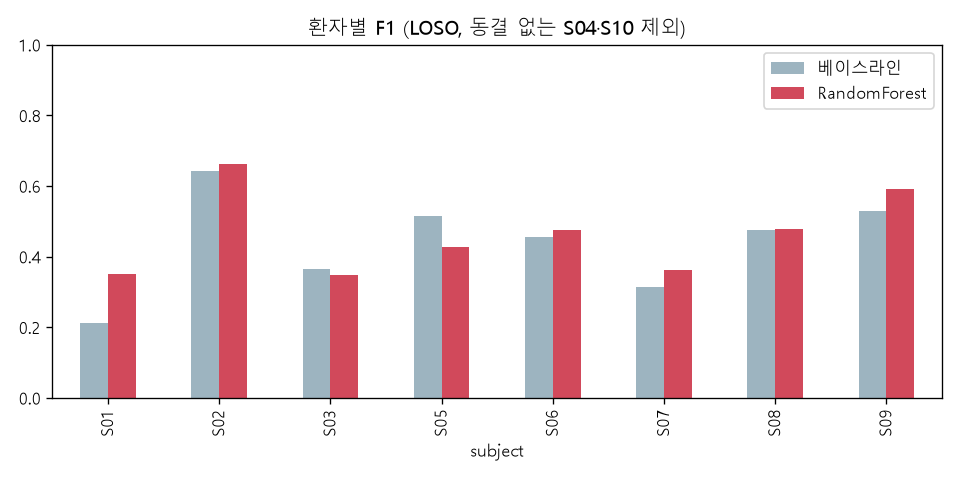

# 모델 성능 비교 (12주차)

`src/train.py`로 생성. 환자 단위 교차검증(LOSO, 10명). 윈도우 2초 / 0.5초 간격. 실험 외(레이블 0) 구간이 섞인 윈도우는 제외.

## 1. 전체 결과

| 방법                         | 민감도   | 특이도   | F1    | 에피소드 감지율   |   감지 지연 중앙값(초) |   S04·S10 오탐(10분당) |
|:---------------------------|:------|:------|:------|:-----------|---------------:|-------------------:|
| 베이스라인 (Freeze Index 임계값)   | 55.6% | 86.6% | 39.7% | 90.7%      |           0.48 |              19.42 |
| RandomForest, 임계값 0.5      | 83.9% | 75.7% | 41.0% | 98.7%      |           0.3  |              26.41 |
| RandomForest, 임계값 0.8 (선택) | 46.0% | 93.2% | 44.0% | 80.2%      |           1.05 |               4.61 |

- 윈도우 단위: 확률(점수) ≥ 임계값이면 동결로 판단 (베이스라인은 학습 환자에서 F1 최대가 되는 Freeze Index·파워 임계값)
- 에피소드 단위: 에이전트처럼 최근 3윈도우 평균 ≥ 임계값이면 알람. 에피소드 시작부터 끝난 뒤 1초 사이에 알람이 켜지면 감지
- 감지 지연: 레이블상 동결 시작 → 첫 알람(윈도우 끝 시각) 시간
- 오탐: 동결이 없는 S04·S10에서 알람이 켜진 횟수. 14주차 에이전트의 "직전에 걷고 있었는가" 조건은 아직 미적용

## 2. 임계값에 따른 변화 (RandomForest)

임계값을 올리면 오탐은 줄지만 감지율이 떨어지고 감지가 늦어진다. 감지 모델만으로는 감지율 80%와 오탐 10분당 1회 이하를 동시에 만족하지 못한다.

|   RF 임계값 | 민감도   | 특이도   | F1    | 에피소드 감지율   |   감지 지연 중앙값(초) |   S04·S10 오탐(10분당) |
|---------:|:------|:------|:------|:-----------|---------------:|-------------------:|
|     0.5  | 83.9% | 75.7% | 41.0% | 98.7%      |           0.3  |              26.41 |
|     0.6  | 79.2% | 81.3% | 44.9% | 97.9%      |           0.36 |              21.1  |
|     0.7  | 68.5% | 86.5% | 46.6% | 93.7%      |           0.42 |              12.86 |
|     0.75 | 58.1% | 89.9% | 46.2% | 91.1%      |           0.48 |               8.66 |
|     0.8  | 46.0% | 93.2% | 44.0% | 80.2%      |           1.05 |               4.61 |
|     0.85 | 27.0% | 96.6% | 34.1% | 49.8%      |           2.09 |               1.12 |

→ 감지율 80% 이상을 지키는 가장 높은 값인 **0.8** 선택. (LOSO 결과를 보고 고른 값이라 실제 성능은 이보다 조금 낮을 수 있음.) 남은 오탐은 14주차 에이전트 조건(직전 걷기 여부, 지속 시간)으로 줄인다.

## 3. 환자별 결과 (윈도우 단위, %)

S04·S10은 동결이 없어서 민감도·F1 계산 불가(NaN 또는 0).

### 베이스라인 (Freeze Index 임계값)

| subject   |   민감도 |   특이도 |   F1 |
|:----------|------:|------:|-----:|
| S01       |  84.8 |  64.9 | 21.2 |
| S02       |  73.1 |  92.1 | 64.3 |
| S03       |  47   |  81.6 | 36.6 |
| S04       | nan   |  93.6 |  0   |
| S05       |  45.5 |  90.7 | 51.4 |
| S06       |  72.7 |  89.5 | 45.6 |
| S07       |  63.4 |  87.4 | 31.4 |
| S08       |  52.1 |  76   | 47.6 |
| S09       |  51.8 |  92   | 53   |
| S10       | nan   |  91.6 |  0   |

### RandomForest, 임계값 0.8 (선택)

| subject   |   민감도 |   특이도 |   F1 |
|:----------|------:|------:|-----:|
| S01       |  81.9 |  83.9 | 35.2 |
| S02       |  62.2 |  96.4 | 66.4 |
| S03       |  36.6 |  87.7 | 34.8 |
| S04       | nan   |  97.3 |  0   |
| S05       |  32.1 |  94.7 | 42.8 |
| S06       |  54.2 |  94.8 | 47.7 |
| S07       |  52.8 |  92.6 | 36.1 |
| S08       |  47.7 |  81.2 | 47.7 |
| S09       |  49   |  97   | 59.2 |
| S10       | nan   |  97.9 |  0   |

## 4. 최종 모델

- 전체 환자로 다시 학습: `models/rf.pkl` (437 KB, pickle 기준. 13주차에 ONNX로 변환해 다시 측정)
- 설정: {'n_estimators': 20, 'max_depth': 6, 'min_samples_leaf': 20, 'class_weight': 'balanced', 'random_state': 0, 'n_jobs': -1}

특징 중요도:

|              |   중요도 |
|:-------------|------:|
| pow_trunk    | 0.204 |
| pow_thigh    | 0.179 |
| fi_ankle     | 0.164 |
| loco_ankle   | 0.099 |
| freeze_ankle | 0.098 |
| domf_ankle   | 0.075 |
| pow_ankle    | 0.057 |
| fi_thigh     | 0.055 |
| domf_trunk   | 0.049 |
| fi_trunk     | 0.02  |
